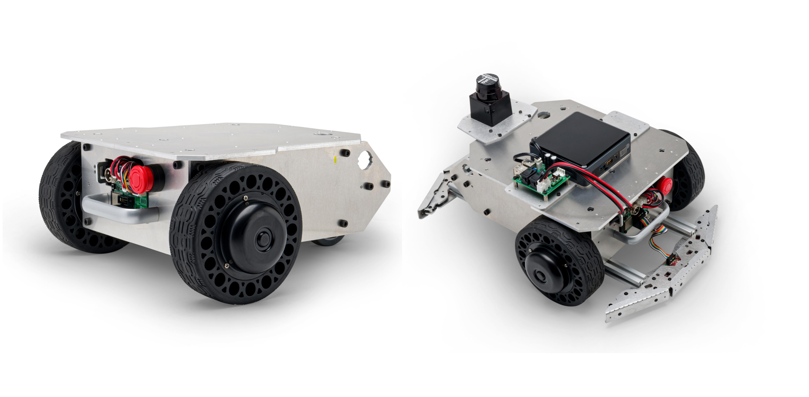

# メガローバーVer.3.0 ROS2パッケージ

<p align="center">
  
</p>

ヴイストン株式会社より発売されている台車ロボット「[メガローバーVer.3.0](https://www.vstone.co.jp/products/wheelrobot/ver.3.0_normal.html)」をROS 2で制御するためのパッケージです。別途Linux搭載のPC及びロボット実機が必要になります。

# 目次
<!-- TOC -->

- [概要](#%E6%A6%82%E8%A6%81)
- [必要機器と動作環境](#必要機器と動作環境)
- [ファイルの構成](#%E3%83%95%E3%82%A1%E3%82%A4%E3%83%AB%E3%81%AE%E6%A7%8B%E6%88%90)
- [パッケージ構成](#%E3%83%91%E3%83%83%E3%82%B1%E3%83%BC%E3%82%B8%E6%A7%8B%E6%88%90)
- [環境セットアップ](#環境セットアップ)
- [使用方法](#%E4%BD%BF%E7%94%A8%E6%96%B9%E6%B3%95)
    - [URDFモデルの表示](#urdf%E3%83%A2%E3%83%87%E3%83%AB%E3%81%AE%E8%A1%A8%E7%A4%BA)
    - [メガローバー（実機）との通信](#%E3%83%A1%E3%82%AC%E3%83%AD%E3%83%BC%E3%83%90%E3%83%BC%E5%AE%9F%E6%A9%9F%E3%81%A8%E3%81%AE%E9%80%9A%E4%BF%A1)
    - [有線シリアル接続の場合](#%E6%9C%89%E7%B7%9A%E3%82%B7%E3%83%AA%E3%82%A2%E3%83%AB%E6%8E%A5%E7%B6%9A%E3%81%AE%E5%A0%B4%E5%90%88)
    - [Wi-Fi 接続の場合](#wi-fi-%E6%8E%A5%E7%B6%9A%E3%81%AE%E5%A0%B4%E5%90%88)
  - [ROS 2トピックとメッセージ](#ros-2%E3%83%88%E3%83%94%E3%83%83%E3%82%AF%E3%81%A8%E3%83%A1%E3%83%83%E3%82%BB%E3%83%BC%E3%82%B8)
  - [odometryをpublish](#odometry%E3%82%92publish)
  - [台車ロボットをROS 2経由で遠隔操作](#%E5%8F%B0%E8%BB%8A%E3%83%AD%E3%83%9C%E3%83%83%E3%83%88%E3%82%92ros-2%E7%B5%8C%E7%94%B1%E3%81%A7%E9%81%A0%E9%9A%94%E6%93%8D%E4%BD%9C)
    - [キーボードで操作](#%E3%82%AD%E3%83%BC%E3%83%9C%E3%83%BC%E3%83%89%E3%81%A7%E6%93%8D%E4%BD%9C)
    - [マウスで操作](#%E3%83%9E%E3%82%A6%E3%82%B9%E3%81%A7%E6%93%8D%E4%BD%9C)
  - [URDFモデルのオプション有効化方法](#urdf%E3%83%A2%E3%83%87%E3%83%AB%E3%81%AE%E3%82%AA%E3%83%97%E3%82%B7%E3%83%A7%E3%83%B3%E6%9C%89%E5%8A%B9%E5%8C%96%E6%96%B9%E6%B3%95)
  - [SLAM](#slam)
    - [SLAM ToolboxでSLAM](#slam-toolbox%E3%81%A7slam)
  - [作成した地図の保存方法](#%E4%BD%9C%E6%88%90%E3%81%97%E3%81%9F%E5%9C%B0%E5%9B%B3%E3%81%AE%E4%BF%9D%E5%AD%98%E6%96%B9%E6%B3%95)
  - [Navigation2を使用したナビゲーション](#navigation2%E3%82%92%E4%BD%BF%E7%94%A8%E3%81%97%E3%81%9F%E3%83%8A%E3%83%93%E3%82%B2%E3%83%BC%E3%82%B7%E3%83%A7%E3%83%B3)
    - [Nav2の利用準備](#nav2の利用準備)
    - [Nav2でナビゲーションする。](#nav2%E3%81%A7%E3%83%8A%E3%83%93%E3%82%B2%E3%83%BC%E3%82%B7%E3%83%A7%E3%83%B3%E3%81%99%E3%82%8B%E3%80%82)
  - [Gazebo](#gazebo)
    - [gazeboシミュレーションの準備](#gazebo%E3%82%B7%E3%83%9F%E3%83%A5%E3%83%AC%E3%83%BC%E3%82%B7%E3%83%A7%E3%83%B3%E3%81%AE%E6%BA%96%E5%82%99)
    - [gazeboでシミュレーションする](#gazebo%E3%81%A7%E3%82%B7%E3%83%9F%E3%83%A5%E3%83%AC%E3%83%BC%E3%82%B7%E3%83%A7%E3%83%B3%E3%81%99%E3%82%8B)
      - [空のワールドを起動する](#%E7%A9%BA%E3%81%AE%E3%83%AF%E3%83%BC%E3%83%AB%E3%83%89%E3%82%92%E8%B5%B7%E5%8B%95%E3%81%99%E3%82%8B)
      - [gazeboでSLAMする](#gazebo%E3%81%A7slam%E3%81%99%E3%82%8B)
      - [gazeboでナビゲーションする](#gazebo%E3%81%A7%E3%83%8A%E3%83%93%E3%82%B2%E3%83%BC%E3%82%B7%E3%83%A7%E3%83%B3%E3%81%99%E3%82%8B)


- [ライセンス](#%E3%83%A9%E3%82%A4%E3%82%BB%E3%83%B3%E3%82%B9)

<!-- /TOC -->

## 概要

このパッケージは、メガローバーVer.3.0台車ロボット用のROS 2パッケージを提供します。  
実機との通信、オドメトリー出力、LiDAR起動、地図作成とナビゲーションに使用するノード・launchファイルが含まれています。

## 必要機器と動作環境
- メガローバーVer.3.0:
  - 製品ページ: [https://www.vstone.co.jp/products/wheelrobot/ver.3.0_normal.html](https://www.vstone.co.jp/products/wheelrobot/ver.3.0_normal.html)
  - 販売ページ: [https://www.vstone.co.jp/robotshop/index.php?main_page=product_info&cPath=156_923&products_id=5338](https://www.vstone.co.jp/robotshop/index.php?main_page=product_info&cPath=156_923&products_id=5338)
- Ubuntu Linux - Jammy Jellyfish (22.04)
- ROS 2 Humble Hawksbill

## ファイルの構成
   ```
    ros2_ws/src
    ├ megarover3_ros2
    │　├ megarover3
    │　├ megarover3_bringup
    │　├ megarover3_navigation
    │　├ megarover3_gazebo
    │　└ megarover_description
    ├ vs_rover_options_description
    └ ydlidar_ros2_driver
   ```

## パッケージ構成
- `megarover3`: メガローバーVer.3.0のメタパッケージ。
- `megarover3_bringup`: メガローバーVer.3.0の起動に関連するノードやlaunchファイルを提供します。
- `megarover3_navigation`: メガローバーVer.3.0のSLAMやnavigationに関連するノードやlaunchファイルを含んでいるパッケージです。
- `megarover_description`: メガローバーVer.3.0の物理モデルやURDFモデルを含んでいるパッケージです。
- `megarover3_gazebo`: メガローバーVer.3.0のgazebo起動に関連するノードやlaunchファイルを提供します。


## 環境セットアップ

PCの環境構築、ROS 2・依存パッケージの導入、本パッケージの取得・ビルドについては、
製品の取扱説明書を参照してください。
取扱説明書に従ってセットアップを完了してから、以下の使用手順を実行してください。

## 使用方法

このパッケージには、以下の主要な機能が含まれています。（詳細は各ファイルを確認してください）

### URDFモデルの表示
以下のコマンドを実行して、メガローバーのURDFモデルを表示します。
rover:=mega3の部分は、使用しているロボットに合わせて変更してください。　対応モデル mega3/f120a
   ```
   ros2 launch megarover_description display.launch.py rover:=mega3
   ```

### メガローバー（実機）との通信
  ROS 2とMicro-ROSを統合するためのエージェントノードを起動。
  
#### 有線シリアル接続の場合
   ```
   ros2 run micro_ros_agent micro_ros_agent serial --dev /dev/ttyUSB0 --baudrate 921600 -v4
   ```
      
#### Wi-Fi 接続の場合
   ```
   ros2 run micro_ros_agent micro_ros_agent udp4 --port 8888
   ```
### ROS 2トピックとメッセージ
本パッケージで使用している主なROS2トピックとメッセージは以下の通りです。  
```
/rover_twist  
   役割：ROS2側からロボットへ送る速度指令トピックです。  

/rover_odo  
   役割：マイコン側からROS2側へ送信されるロボットの自己運動情報です。  
       （線速度・角速度が含まれます）

/rover_sensor  
   役割：マイコン側からROS2側へ送信されるセンサ情報です。  
      ・配列要素  
         - data[0]：デジタル入力の値  
         - data[1]：バッテリー電圧値  
```
### odometryをpublish
pub_odomノードとrviz上可視化
   ```
   ros2 launch megarover3_bringup robot.launch.py rover:=mega3
   ```

### 台車ロボットをROS 2経由で遠隔操作
#### キーボードで操作
キーボードを使用してロボットを操作するためのノードを起動。
   ```
   ros2 run teleop_twist_keyboard teleop_twist_keyboard --ros-args --remap cmd_vel:=rover_twist
   ```

#### マウスで操作
マウスを使用してロボットを操作するためのノードを起動。
   ```
   ros2 launch megarover3_bringup mouse_teleop.launch.py
   ```
### URDFモデルのオプション有効化方法
megarover_description/urdf/mega3.xacroに定義されている各種オプションはコメントの切り替えによって有効／無効を設定できます。  
ここでは、LRF TG30オプションを例に設定手順を説明します。  
1. オプションの有効化
   コメントアウトを解除して、該当オプションを読み込むようにします。

      ```
      <!-- OPTION: LRF TG30 -->
      <xacro:include filename="$(find vs_rover_options_description)/urdf/lrf/tg30_mega3.xacro" />
      ```

2. オプションの無効化
   オプションを使用しない場合は、行全体をコメントアウトしてください。

      ```
      <!-- OPTION: LRF TG30 -->
      <!-- <xacro:include filename="$(find vs_rover_options_description)/urdf/lrf/tg30_mega3.xacro" /> -->
      ```

3. 反映確認
   設定を保存後、以下のコマンドでURDFモデルを確認できます。
   RViz2上でLRF（TG30）が表示されていれば、有効化が正しく反映されています。
   rover:=mega3の部分は、使用しているロボットに合わせて変更してください。　対応モデル mega3/f120a/s40a_lb

      ```
      ros2 launch megarover_description display.launch.py rover:=mega3
      ```

## SLAM
### SLAM ToolboxでSLAM

本パッケージのSLAM機能はSLAM Toolboxを使用します。
`slam.launch.py`は非同期モード、`slam_sync.launch.py`は同期モードを起動します。
以下は実機とLRFオプションTG30で地図を作成する手順です。

1. 取扱説明書に従い、TG30用ドライバーとSLAM Toolboxのセットアップを完了してください。

   LRFの設定は[TG30.yaml](./megarover3_bringup/params/TG30.yaml)にあります。
   TG30のシリアルポートの既定値は`/dev/ttyUSB1`です。micro-ROS Agentの例の`/dev/ttyUSB0`とは区別してください。
   実際の接続先に合わせて`lidar_port`を指定でき、`/dev/serial/by-id/`のデバイス名も使用できます。
   LiDAR単体の設定確認には`ydlidar_tg30_launch.py`を使用します。`nav_robot.launch.py`と重複して起動しないでください。
   独自パラメータファイルは、単体起動時の`params_file:=/absolute/path/TG30.yaml`で指定できます。
   `lidar_port`を省略するとそのファイルのポートを使用し、指定するとポートだけを上書きします。読み取り除外角度などの設定は維持します。
   「URDFモデルのオプション有効化方法」に従ってTG30を設定し、センサーのTFを用意します。

2. 「メガローバー（実機）との通信」の手順でmicro-ROS Agentを起動します。
   `robot.launch.py`が起動済みの場合は、その端末でCtrl+Cを押して終了します。
   モデル表示・オドメトリー・LiDARをまとめて起動してください。

   ```bash
   source ~/ros2_ws/install/local_setup.bash
   ros2 launch megarover3_bringup nav_robot.launch.py rover:=mega3
   ```

   F120Aでは`rover:=f120a`を指定します。ポートの変更には`lidar_port:=/dev/ttyUSB2`などを追加できます。

3. 新しいターミナルでSLAM Toolboxを起動します。

   ```bash
   source ~/ros2_ws/install/local_setup.bash
   ros2 launch megarover3_navigation slam.launch.py use_sim_time:=false
   ```

   `/scan`、`/odom`、センサーのTFを使って地図を作成します。
   RVizのFixed Frameは`map`を使用します。
   同期モードを使用する場合は、`slam.launch.py`の代わりに`slam_sync.launch.py`を指定してください。

4. 付属のVS-C3無線コントローラ、またはROS 2のteleopでロボットを動かします。
   キーボードで操作する場合は、新しいターミナルで次を実行します。

   ```bash
   ros2 run teleop_twist_keyboard teleop_twist_keyboard --ros-args --remap cmd_vel:=rover_twist
   ```

SLAM Toolboxの設定は、非同期用の[mapper_params_online_async.yaml](./megarover3_navigation/config/mapper_params_online_async.yaml)と
同期用の[mapper_params_online_sync.yaml](./megarover3_navigation/config/mapper_params_online_sync.yaml)にあります。
地図の保存後にNav2へ切り替える場合は、SLAMとteleopを終了してください。
micro-ROS Agentと`nav_robot.launch.py`は引き続き使用できます。

### 作成した地図の保存方法
下記のコマンドで地図を`megarover3_ros2/megarover3_navigation/maps/`フォルダ内に保存する。
   ```
   ros2 run nav2_map_server map_saver_cli -f ~/ros2_ws/src/megarover3_ros2/megarover3_navigation/maps/YOUR_MAP_NAME
   ```
## Navigation2を使用したナビゲーション
### Nav2の利用準備

Nav2に必要な依存パッケージの導入については、製品の取扱説明書を参照してください。

### Nav2でナビゲーションする。
   地図ファイルは map:= 引数で指定してください（launchファイル編集は不要）。
   例: map:=~/ros2_ws/src/megarover3_ros2/megarover3_navigation/maps/YOUR_MAP_NAME.yaml

1. ロボット実機と通信できたら、以下のコマンドでpub_odom、ロボットのurdf表示、LiDAR関連のlaunchファイルを起動します。
   ```
   ros2 launch megarover3_bringup nav_robot.launch.py rover:=mega3
   ```
   
2. 新しいターミナルで以下のコマンドを使用してナビゲーションを開始します。  
   map:= は使用したい地図 YAML のフルパスを指定してください（例: map:=~/ros2_ws/src/megarover3_ros2/megarover3_navigation/maps/YOUR_MAP_NAME.yaml）。

      ```
      ros2 launch megarover3_navigation navigation.launch.py rover:=mega3 map:=~/ros2_ws/src/megarover3_ros2/megarover3_navigation/maps/YOUR_MAP_NAME.yaml
      ```
- メガローバーVer.3.0用のNavigation2のパラメータは`megarover3_navigation`パッケージの[`config`](./megarover3_navigation/config/) フォルダにあります。  
roverタイプごとにパラメータファイルが分かれていますので、使用しているロボットに合わせて調整してください。

> **Warning**  
   > ナビゲーションを行う場合、移動命令のrover_twistトピックが競合しないようにするため、rover_twistをpublishするノードは起動しないでください。  
   > 付属のVS-C3無線コントローラはROS2経由で操作するわけではないため、緊急時の手動操作として使用可能です。
## Gazebo

既存のGazeboが動作している場合やマスターポート11345が使用中の場合は、起動を中断します。
既存のSLAMやGazeboを自動終了しません。競合するGazeboは、起動元の端末で終了してください。
このlaunchを終了すると、今回のlaunchで起動した処理を終了し、今回生成した一時ファイルだけを削除します。

### gazeboシミュレーションの準備

Gazeboの導入と環境設定については、製品の取扱説明書を参照してください。

### gazeboでシミュレーションする
#### 空のワールドを起動する  
床とロボットモデルのみ存在するベースワールドになります。他プログラムと連携する際に利用することを想定したlaunchファイルです。
  1. 空のワールドを起動します。
      ```
      ros2 launch megarover3_gazebo gazebo_bringup.launch.py rover:=mega3
      ```

  2. 壁をシミュレータ内にインポートします。  
      wall:=Wall.stlの部分は、megarover3_gazebo/models内にあるSTLファイルに書き換えることで、壁としてシミュレータ内にインポートすることができます。
      ```
      ros2 launch megarover3_gazebo spawn_wall.launch.py wall:=Wall.stl
      ```

  3. ローバーをマウスで遠隔操作するには、新しいターミナル ウィンドウで以下のコマンドを使用して遠隔操作ノードを起動します。
      ```
      ros2 launch megarover3_bringup mouse_teleop.launch.py
      ```

#### gazeboでSLAMする  
gazebo内のワールドの地図データを作成することができます。
  1. gazebo serverとSLAMノードを起動します。
      ```
      ros2 launch megarover3_gazebo gazebo_slam.launch.py rover:=mega3  wall:=Wall.stl
      ```

  2. ローバーをマウスで遠隔操作するには、新しいターミナル ウィンドウで以下のコマンドを使用して遠隔操作ノードを起動します。
      ```
      ros2 launch megarover3_bringup mouse_teleop.launch.py
      ```

  3. 下記のコマンドで地図を`megarover3_ros2/megarover3_gazebo/maps/`フォルダ内に保存する。  
   YOUR_MAP_NAMEは保存したい地図の名前に置き換えてください。
      ```
      ros2 run nav2_map_server map_saver_cli -f ~/ros2_ws/src/megarover3_ros2/megarover3_gazebo/maps/YOUR_MAP_NAME
      ```

#### gazeboでナビゲーションする。
使用する地図は map:= 引数で指定してください（launchファイル編集は不要）。

```bash
ros2 launch megarover3_gazebo gazebo_nav.launch.py rover:=mega3 wall:=Wall.stl map:=~/ros2_ws/src/megarover3_ros2/megarover3_gazebo/maps/YOUR_MAP_NAME.yaml
```

gazebo_nav.launch.py は use_sim_time:=true がデフォルトです。
> **Warning**  
   > ナビゲーションを行う場合、移動命令のrover_twistトピックが競合しないようにするため、rover_twistをpublishするノードは起動しないでください。


## ライセンス

このパッケージはApache 2.0ライセンスの下で提供されています。詳細については、[LICENSE](./LICENSE)ファイルを参照してください。
